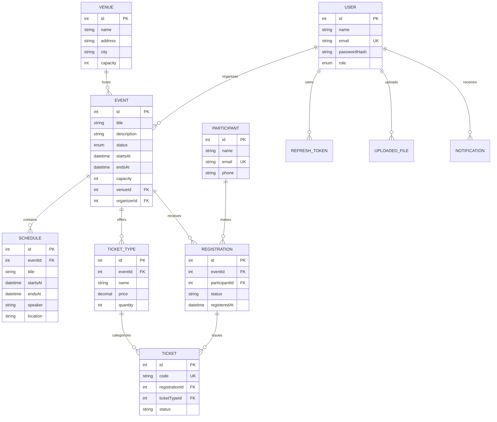

# ER-діаграма Event Management System

## Основні зв'язки

- Один організатор може створити багато подій; кожна подія має одного організатора.
- Одна локація може приймати багато подій; подія може бути без призначеної локації.
- Подія містить багато пунктів розкладу та типів квитків.
- Учасник може реєструватися на різні події; для пари «подія — учасник» встановлено унікальне обмеження.
- Реєстрація може містити один або кілька квитків.
- Кожен квиток належить одному типу квитка.
